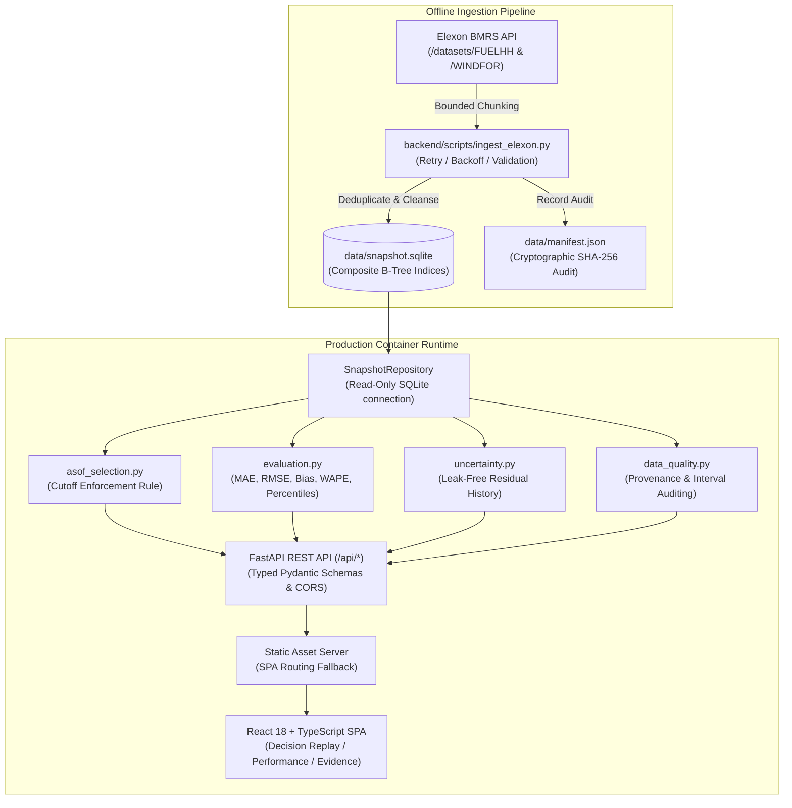

# System Architecture & Technical Design

## 1. System Overview

The **REint Decision-Time Wind Forecast Intelligence Portal** is architected as a robust, single-container modular monolith. It provides sub-second decision replay and evaluation without relying on external network requests at runtime.

---

## 2. Key Architecture Decisions & Trade-Offs

### 2.1 Ingestion Separated from Serving
- **Decision**: Live Elexon API requests are performed offline via `backend/scripts/ingest_elexon.py`. The resulting verified data snapshot (`data/snapshot.sqlite`) is bundled directly into the Docker image.
- **Rationale**:
  - Eliminates runtime dependency on third-party API availability, rate limits, and latency spikes.
  - Guarantees deterministic, reproducible backtesting across evaluation runs.
  - Delivers sub-50ms API response times directly from indexed local storage.

### 2.2 Storage: SQLite with Composite B-Tree Indices
- **Decision**: Bundled read-only SQLite database with composite indices on `(publish_time, start_time)` and `(start_time)`.
- **Rationale**:
  - Compact footprint (~6.1 MB for 21,024 forecast rows and 1,776 actuals).
  - Native Python standard library support (`sqlite3`), eliminating binary dependency incompatibilities.
  - Enforced OS/SQLite-level read-only mode (`file:snapshot.sqlite?mode=ro`).
  - Thread-safe, atomic queries and sub-millisecond filtering.

### 2.3 Modular Monolith Architecture
- **Decision**: Single Docker container containing FastAPI backend and compiled React static assets.
- **Rationale**:
  - No distributed system complexity (no Redis, Kafka, Kubernetes, or separate reverse proxy needed).
  - Single deployment target for Heroku, Vercel, or local Docker Compose.
  - Complete SPA direct-navigation support via FastAPI route fallback (`index.html`).

### 2.4 Domain Isolation in Pure Functions
- **Decision**: Selection algorithms, metrics computation, and uncertainty estimation live in standalone Python modules (`backend/app/services/`).
- **Rationale**:
  - 100% unit-testable without mocking HTTP requests or databases.
  - Makes code structure self-documenting and auditable for technical review.

### 2.5 Bespoke Modern CSS Design System
- **Decision**: Vanilla CSS design tokens with custom interactive SVG charts and calendar matrix heatmap.
- **Rationale**:
  - Complete control over design aesthetics (trading desk dark theme, glassmorphic blur, emerald/amber accent hierarchy).
  - Eliminates dependency churn and version conflicts from external chart libraries.
  - Zero layout shift and immediate DOM rendering.
